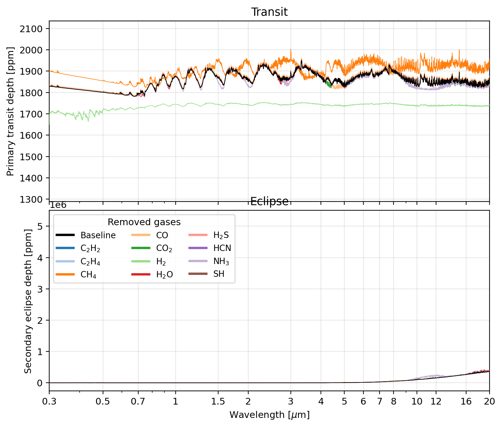

# Postprocessing and chemistry

After a PROTEUS simulation has run, its atmospheric state can be postprocessed to compute detailed chemistry, synthetic observations, and multi-angle thermal profiles. This page covers all three workflows.

## Atmospheric chemistry with VULCAN

PROTEUS can run the [VULCAN](https://github.com/FormingWorlds/VULCAN) chemical kinetics model on the atmospheric state it has simulated. Chemistry is always computed **after** the PROTEUS simulation, never inside its time loop: each run takes one atmosphere snapshot (its temperature-pressure profile, eddy diffusion and composition) and the star and planet at that time, and integrates the kinetics to a steady state. The chemistry does not feed back on the climate or the evolution. Coupled (online) chemistry is not yet implemented.

VULCAN needs `atmos_chem.module = "vulcan"` and the AGNI atmosphere (`atmos_clim.module = "agni"`). `atmos_chem.module = "dummy"` writes parameterised profiles in the same format without a kinetics solver, for testing.

Two options set the chemistry runs: `atmos_chem.mode` sets **whether** they run automatically, and `atmos_chem.times` sets **which snapshots** they run on.

### When chemistry runs: `atmos_chem.mode`

| `atmos_chem.mode` | At the end of `proteus start` | With `proteus offchem -c [cfgfile]` |
|---|---|---|
| `"none"` (default) | Not run | Runs at `atmos_chem.times` |
| `"offline"` | Runs at `atmos_chem.times` once the simulation stops on a termination criterion; not after a fatal error | Runs at `atmos_chem.times` |
| `"online"` | Rejected when the config is loaded: not yet implemented | Rejected |

`mode = "offline"` needs a chemistry module; a config with `mode = "offline"` and `module = "none"` is rejected. `proteus offchem` runs the chemistry whatever the mode, so a finished run can be postprocessed with other chemistry settings (for example another network, or photochemistry off) without running the evolution again:

```console
proteus offchem -c [cfgfile]
```

After a fatal error the snapshots written so far stay on disk, and `proteus offchem` can postprocess them.

### Which snapshots: `atmos_chem.times`

| `atmos_chem.times` | Snapshots processed | Number of chemistry runs |
|---|---|---|
| `"end"` (default) | The final state of the simulation | 1 |
| `"all"` | Every atmosphere snapshot, `data/<time>_atm.nc` | One per snapshot |
| `[t1, t2, ...]` | For each time [yr], the atmosphere snapshot nearest it; a snapshot nearest two times runs once | Up to the length of the list |

The snapshots run in order of increasing time. Which atmosphere snapshots exist is set by `params.out.write_mod` and `params.out.dt_write_rel`. An atmosphere module that writes no snapshots (the dummy) leaves the helpfile times as the snapshots. Each run uses the helpfile row of its own snapshot for the surface composition, the stellar spectrum and the planet radius and gravity. A snapshot without an atmosphere (zero surface pressure, as after desiccation) is left out, both at the end of a run and with `proteus offchem`. If a run fails, the sequence stops with an error; the results of the snapshots before it are kept.

### Initial composition: `atmos_chem.vulcan.ini_mix`

VULCAN integrates from an initial composition to a steady state, and the initial composition changes how many steps it needs to converge.

| `ini_mix` | Initial composition | Requirement |
|---|---|---|
| `"profile"` (default) | The mixing ratio profile of the atmosphere snapshot, interpolated in log pressure onto the VULCAN grid | |
| `"outgas"` | The outgassed surface mixing ratios at every level | |
| `"previous"` | The result of the latest earlier chemistry snapshot (`data/<time>_chem.nc` with a smaller time), interpolated in log pressure onto the VULCAN grid. Falls back to `"profile"` when there is none, as for the first snapshot | `atmos_chem.vulcan.fix_surf = true` |

`"previous"` is meant for `times = "all"` or a list, where consecutive snapshots are close in time and in composition, to help convergence. It needs a fixed surface composition (`fix_surf = true`), so that the outgassed surface mixing ratios of each snapshot, not the composition carried over from the earlier one, set the lower boundary. The earlier result can come from an earlier chemistry call on the same run directory, since `data/*_chem.nc` is kept between calls.

### Output files

Snapshot times in file names use the sub-year form of the other snapshots: `12p320` for t = 12.32 yr.

| File | Content |
|---|---|
| `data/<time>_chem.nc` | VULCAN NetCDF output of one snapshot, in CGS units: structure, mixing ratios (`x_gas`), number densities, reaction rates and element conservation |
| `offchem/<module>_<time>.csv` | Table of one snapshot, from the top of the atmosphere down: temperature `tmp` [K], pressure `p` [Pa], height `z` [m], `Kzz` [cm2 s-1] and the mixing ratio of each gas |
| `offchem/<module>.csv` | Copy of the table at the latest snapshot processed |
| `offchem/mix.*`, `offchem/evo.*` | VULCAN's plots of the mixing ratios and their evolution, for the latest snapshot processed (each run overwrites them) |

Each chemistry call first clears `offchem/` (and its VULCAN input files), while the `data/*_chem.nc` files are kept. At the end of a run the `_chem.nc` files are packed into `data/data.tar` with the other snapshots when archiving is on (`params.out.archive_mod`). Before chemistry runs, at the end of a run or with `proteus offchem`, an existing archive is unpacked. VULCAN logs into the PROTEUS log file (`proteus_*.log`, or `offchem.log` for `proteus offchem`), and each run starts with a line naming its snapshot time.

The synthetic observations with `observe.source = "offchem"` read the table at their own time, the end of the run, so `atmos_chem.times` has to include the end for them. The chemistry plot (`plots/plot_chem_atmosphere.*`) shows the latest chemistry snapshot at its own pressures, together with the atmosphere snapshot nearest it. `plot_chem_atmosphere(..., time=t)` in `proteus.plot.cpl_chem_atmosphere` plots the chemistry snapshot nearest the time `t` [yr] instead.

### Examples

Run VULCAN once on the final state, automatically at the end of the simulation:

```toml
[atmos_chem]
    module = "vulcan"
    mode   = "offline"
    times  = "end"
```

Postprocess every snapshot, each run starting from the result of the one before:

```toml
[atmos_chem]
    module = "vulcan"
    mode   = "offline"
    times  = "all"

    [atmos_chem.vulcan]
        ini_mix  = "previous"
        fix_surf = true
```

Run nothing automatically, then postprocess three chosen times with `proteus offchem -c [cfgfile]`:

```toml
[atmos_chem]
    module = "vulcan"
    mode   = "none"
    times  = [1e3, 1e5, 1e7]   # yr
```

### Chemistry configuration

The chemistry behaviour is further controlled by settings under `[atmos_chem]` and `[atmos_chem.vulcan]` in the configuration file. Key options include:

- `atmos_chem.vulcan.network`: Chemical network to use (`"CHO"`, `"NCHO"`, or `"SNCHO"`)
- `atmos_chem.photo_on`: Enable photochemistry
- `atmos_chem.Kzz_on`: Enable eddy diffusion mixing

See the [atmosphere and chemistry reference](../Reference/config/atmosphere.md) for the full list of options.

## Synthetic observations

PROTEUS can generate synthetic transit and eclipse depth spectra from the
simulated atmospheric state using [petitRADTRANS](https://petitradtrans.readthedocs.io/).
Spectra are produced as "perfect" observations — no telescope noise model is
applied — so they represent the intrinsic planetary signal.

Access the synthetic-observation functionality via the CLI:

```console
proteus observe -c [cfgfile]
```

PROTEUS also runs this step automatically at the end of a simulation when
`observe.module = "petitRADTRANS"` is set in the configuration file.

### Composition sources

Spectra are computed from composition sources controlled by `observe.source`:

- `all` (default): run all available sources below
- `outgas`, `profile`, or `offchem`: run only that source

Available sources:

| Source | Description | Skipped when |
|--------|-------------|--------------|
| `outgas` | Constant-with-height VMR from the outgassing module | Never |
| `profile` | Full T(p) + VMR profile from the atmosphere NetCDF | `atmos_clim.module = "dummy"` |
| `offchem` | Photochemical mixing ratios from VULCAN | `atmos_chem.module` is `none` |

### Output files

For each source, two CSV files are written to `observe/` inside the run
directory:

- `transit_<source>_synthesis.csv` — primary transit depth
- `eclipse_<source>_synthesis.csv` — secondary eclipse depth

Use `observe.spectrum_type` to choose which products are written:

- `both` (default): writes both files above
- `transit`: writes only `transit_<source>_synthesis.csv`
- `eclipse`: writes only `eclipse_<source>_synthesis.csv`

Both files are tab-separated with the following column layout:

| Column | Description |
|--------|-------------|
| `Wavelength/um` | Wavelength \[μm\] |
| `None/ppm` | Baseline depth \[ppm\] with all species present |
| `<SPECIES>_removed/ppm` | Depth \[ppm\] with that species removed (one column per line species in the mix) |

Set `observe.remove_one_gas = false` to disable the
`<SPECIES>_removed/ppm` columns and write baseline-only spectra.

The baseline column uses the full set of line species found in the
petitRADTRANS opacity table directory (`$FWL_DATA/prt/input_data`). Species
below the `clip_vmr` threshold are excluded.

### Plotting

The `plot_spectra` diagnostic produces a two-panel PDF figure:

- **Upper panel**: primary transit depth as a function of wavelength.
- **Lower panel**: secondary eclipse depth as a function of wavelength.

Both panels overlay the baseline spectrum (black) with all per-species
removed spectra (coloured by species). The figure is saved to
`plots/plot_spectra_profile.pdf` (or `.png` depending on `params.out.plot_fmt`).

<figure markdown="span">
  
  <figcaption><b>Example <code>plot_spectra</code> output.</b>
  Upper panel: primary transit depth \[ppm\]. Lower panel: secondary eclipse depth \[ppm\].
  The black line is the baseline (all species present); coloured lines show the spectrum
  with each gas removed in turn.</figcaption>
</figure>

See the [Observations configuration reference](../Reference/config/observe.md)
for all available options.


## Multiprofile analysis with AGNI

PROTEUS can postprocess the planet's atmosphere for a number of zenith angles. This yields localised thermal profiles based on the angle of irradiation on the atmosphere, which is particularly useful for tidally locked planets.

Access this functionality via the CLI, from within the PROTEUS directory:

```console
julia tools/multiprofile_postprocess.jl output/[outputdir] 0,36,45,89
```

This example computes results for four zenith angles (`0, 36, 45, 89`), but the script works for any number of zenith angles and creates a new `..._atm_z{angle}.nc` file in the `data/` directory of the output folder for each angle.

---

**See also:** [Usage overview](usage.md) | [Running and output](usage_running.md) | [Atmosphere and chemistry reference](../Reference/config/atmosphere.md) | [Observations reference](../Reference/config/observe.md) | [VULCAN submodule](https://proteus-framework.org/VULCAN/)
