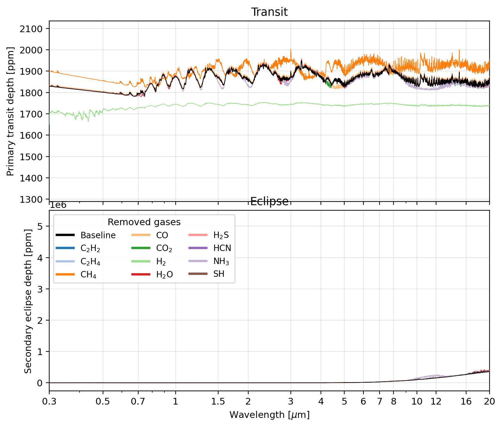

# Postprocessing and chemistry

After a PROTEUS simulation has run, its atmospheric state can be postprocessed to compute detailed chemistry, synthetic observations, and multi-angle thermal profiles. This page covers all three workflows.

## Atmospheric chemistry with VULCAN

PROTEUS can run the [VULCAN](https://github.com/FormingWorlds/VULCAN) chemical kinetics model on the atmospheric state it has simulated. VULCAN needs `atmos_chem.module = "vulcan"` and the AGNI atmosphere (`atmos_clim.module = "agni"`). `atmos_chem.module = "dummy"` writes parameterised profiles in the same format without a kinetics solver, for testing.

### When chemistry runs: `atmos_chem.mode`

| `atmos_chem.mode` | At the end of `proteus start` | With `proteus offchem -c [cfgfile]` |
|---|---|---|
| `"none"` (default) | Not run | Runs at `atmos_chem.times` |
| `"offline"` | Runs at `atmos_chem.times` once the simulation stops on a termination criterion; not after a fatal error | Runs at `atmos_chem.times` |
| `"online"` | Rejected when the config is loaded: not yet implemented | Rejected |

`proteus offchem` runs the chemistry whatever the mode, so a finished run can be postprocessed with other chemistry settings (for example another network, or photochemistry off) without running the evolution again:

```console
proteus offchem -c [cfgfile]
```

### Which snapshots: `atmos_chem.times`

| `atmos_chem.times` | Snapshots processed | Number of chemistry runs |
|---|---|---|
| `"end"` (default) | The final state of the simulation | 1 |
| `"all"` | Every atmosphere snapshot, `data/<time>_atm.nc` | One per snapshot |
| `[t1, t2, ...]` | For each time (yr), the first helpfile row at or after it, as `{Time = [t1, t2, ...]}`; times that give the same row run once | Up to the length of the list |
| `{key = [v1, v2, ...], ...}` | For each value, every helpfile row at which the column `key` reaches or crosses it (see below) | One per crossing |

The snapshots run in order of increasing time. Each target uses the latest atmosphere snapshot at or before its row, and each snapshot the latest helpfile row and stellar spectrum at or before its time: the state and spectrum the run had reached then, never a later one. A snapshot that AGNI treats as transparent (surface pressure below `atmos_clim.agni.psurf_thresh`) has no atmosphere to process, so it is skipped with a warning, as is a snapshot after desiccation.

#### States of the evolution: a table of helpfile columns

To run the chemistry at a state of the planet rather than at a fixed time, give `times` a table. Each key is a column of the helpfile (`runtime_helpfile.csv`), and each value is in that column's unit (see the [output reference](../Reference/output.md)): `T_surf` in K, `P_surf` in bar, `Phi_global` as a fraction, `Time` in years.

```toml
[atmos_chem]
    times = {Time = [1e2, 1e4, 1e6], Phi_global = [0.01], T_surf = [1500.0], end = true}
```

A value selects **every** row at which its column reaches it or crosses it, in either direction. A melt fraction that rises again after a giant impact and then falls crosses `Phi_global = 0.5` three times, giving three chemistry runs. `Time = [t]` selects the first row at or after `t`. `end = true` adds the final state. A value that is never reached is skipped with a warning.

With a list or a table, the run writes an atmosphere snapshot, and the helpfile, on each step that reaches a target, besides those it writes every `params.out.write_mod` steps, so each target has a snapshot of its own. A run made before this, or a target reached during the initialisation steps, uses the latest snapshot before the target instead, with a warning.

The chemistry of a snapshot uses the stellar spectrum that the climate of that snapshot used. A new spectrum is written every `params.dt.starspec` years, so set that interval short enough for the targets you choose.

### Initial composition: `atmos_chem.vulcan.ini_mix`

VULCAN integrates from an initial composition to a steady state, and the initial composition changes how many steps it needs to converge.

| `ini_mix` | Initial composition | Requirement |
|---|---|---|
| `"profile"` (default) | The mixing ratio profile of the atmosphere snapshot, interpolated in log pressure onto the VULCAN grid | |
| `"outgas"` | The outgassed surface mixing ratios are  used at every level | |
| `"previous"` | The result of the latest earlier chemistry snapshot, interpolated to new pressure grid | `atmos_chem.vulcan.fix_surf = true` |

`"previous"` is meant for `times = "all"` or a list, where consecutive snapshots are close in time and in composition, to help convergence.

### Bottom boundary condition

The bottom of the VULCAN column is the planet's surface. With `atmos_chem.vulcan.fix_surf = true` the mixing ratios are held at the outgassed surface values. With `false` (default), the surface VMRs are allowed to vary.

### Top boundary condition

The top of the column is set by `atmos_chem.vulcan.escape_bc`:

| `escape_bc` | Upper boundary | Requirement |
|---|---|---|
| `false` (default) | No gas crosses the top | |
| `true` | Each atom escapes at the rate PROTEUS computed for the snapshot | `fix_surf = true` |

With `escape_bc = true`, the escape rate of each element $e$ in the helpfile, `esc_rate_<e>` in kg s$^{-1}$, becomes a number flux of atoms through a sphere of radius `R_xuv`, the radius where the escape module evaluates escape:

$$F_e = \frac{\dot{M}_e \, N_A}{M_e \, 4 \pi R_\mathrm{xuv}^2}$$

A value of `R_xuv` below the surface radius `R_int`, including zero when the escape module leaves it unset, is replaced by `R_int`.

- Only the atoms in the network get a non-zero flux.
- VULCAN keeps the total number density of every layer fixed by hydrostatic balance, so escape changes the composition, not the pressure.
- The fluxes are constant during the VULCAN run, at the rates of the snapshot.
- VULCAN treats the column as plane-parallel, one unit of surface area. Spread over an `R_xuv` surface, the column loses atoms at a rate of $(R_\mathrm{int}/R_\mathrm{xuv})^2$ the PROTEUS escape rate.
- Atomic species are generated mostly by photolysis, so without photochemistry (`atmos_chem.photo_on = false`) PROTEUS logs a warning.
- With a free surface boundary condition, the mass budget will not be closed, so `escape_bc = true` requires `fix_surf = true`.

### Chemistry and climate together: `atmos_chem.vulcan.couple_agni`

By default VULCAN keeps the temperature and eddy diffusion ($K_{zz}$) profiles of the snapshot, which AGNI solved with the outgassed composition, the same at every height. The gases that VULCAN makes and destroys change the radiation, and so the temperature. With `couple_agni = true` the climate is solved again from the composition VULCAN computes, until the two agree:

```toml
[atmos_chem]
    module = "vulcan"
    mode   = "offline"

    [atmos_chem.vulcan]
        couple_agni    = true
        agni_call_frq  = 0      # climate updates only at the steady states of the chemistry
        agni_T_rtol    = 0.01   # settled when an update changes T by at most 1 % in every layer
        agni_max_calls = 10
```

PROTEUS sets AGNI up as it did for the snapshot, with the same configuration, surface condition and stellar spectrum, and loads the snapshot into it. Each time the chemistry reaches a steady state, AGNI solves the climate with VULCAN's composition, and VULCAN continues with the new temperature and $K_{zz}$ until an update leaves the temperature unchanged within `agni_T_rtol`. A positive `agni_call_frq` also updates the climate every that many VULCAN steps. AGNI's own equilibrium chemistry is off in these solves, and `atmos_chem.Kzz_const`, when set, keeps $K_{zz}$ fixed. The coupled climate is written to `data/<time>_chematm.nc`, beside the snapshot, and the log gives its net flux at the top of the atmosphere against that of the evolution. The interior does not see this climate: the coupled state is a diagnostic of the snapshot, not a step of the evolution. When the temperature settles, VULCAN saves the state from before that last update, the one its chemistry is steady for. A VULCAN run that stopped at its time or step limit, or with the climate still changing after `agni_max_calls` updates, is kept and reported with a warning. This needs `atmos_clim.module = "agni"` with `atmos_clim.agni.solve_energy = true`, since a prescribed profile does not respond to the composition.

### Output files

Snapshot times in file names use the sub-year form of the other snapshots: `12p320` for t = 12.32 yr.

| File | Content |
|---|---|
| `data/<time>_chem.nc` | VULCAN NetCDF output of one snapshot, in CGS units |
| `offchem/<module>_<time>.csv` | Table of one snapshot, from the top of the atmosphere down. |
| `offchem/<module>.csv` | Copy of the table at the latest snapshot processed |
| `data/<time>_chematm.nc` | With `couple_agni`, the AGNI climate solved with the chemistry of that snapshot |
| `offchem/mix.*`, `offchem/evo.*` | VULCAN's plots of the mixing ratios and their evolution |

Each chemistry call first clears `offchem/` (and its VULCAN input files), while the `data/*_chem.nc` files are kept. The chemistry plot (`plots/plot_chem_atmosphere.*`) shows the latest chemistry snapshot.

### Examples

Run VULCAN once on the final state, automatically at the end of the simulation:

```toml
[atmos_chem]
    module = "vulcan"
    mode   = "offline"
    times  = "end"
```

Postprocess every snapshot, each run starting from the result of the one before:

```toml
[atmos_chem]
    module = "vulcan"
    mode   = "offline"
    times  = "all"

    [atmos_chem.vulcan]
        ini_mix  = "previous"
        fix_surf = true
```

Run nothing automatically, then postprocess three chosen times with `proteus offchem -c [cfgfile]`:

```toml
[atmos_chem]
    module = "vulcan"
    mode   = "none"
    times  = [1e3, 1e5, 1e7]   # yr
```

### Grids

`proteus offchem --grid` (or `-g`) runs the chemistry on every case of a [grid](usage_grids.md) that has a helpfile:

```console
proteus offchem -g output/<grid folder>           # run the cases here
proteus offchem -g output/<grid folder> --slurm   # write a Slurm job array instead
```

- Each case runs `proteus offchem` with its own config, so `atmos_chem.module` must be set in every case.
- `max_jobs` of the grid file sets how many cases run at once. With `--slurm`, the command writes `slurm_offchem.sh` to submit with `sbatch`, which packs the cases into jobs by `cores_per_job`, with `max_days` and `max_mem` per case, as the grid run does.
- VULCAN compiles one chemical network file per local installation, so this command compiles it once, before any case runs, and refuses cases that use different networks. 
- The log of the command is `offchem.log` in the grid output folder, and the output of each case is in `logs/offchem/`.

### Chemistry configuration

The chemistry behaviour is further controlled by settings under `[atmos_chem]` and `[atmos_chem.vulcan]` in the configuration file. Key options include:

- `atmos_chem.vulcan.network`: Chemical network to use (`"CHO"`, `"NCHO"`, or `"SNCHO"`; VULCAN has SNCHO only with photochemistry)
- `atmos_chem.photo_on`: Enable photochemistry
- `atmos_chem.Kzz_on`: Enable eddy diffusion mixing

See the [atmosphere and chemistry reference](../Reference/config/atmosphere.md) for the full list of options.

## Synthetic observations

PROTEUS can generate synthetic transit and eclipse depth spectra from the
simulated atmospheric state using [petitRADTRANS](https://petitradtrans.readthedocs.io/).
Spectra are produced as "perfect" observations — no telescope noise model is
applied — so they represent the intrinsic planetary signal.

Access the synthetic-observation functionality via the CLI:

```console
proteus observe -c [cfgfile]
```

PROTEUS also runs this step automatically at the end of a simulation when
`observe.module = "petitRADTRANS"` is set in the configuration file.

### Composition sources

Spectra are computed from composition sources controlled by `observe.source`:

- `all` (default): run all available sources below
- `outgas`, `profile`, or `offchem`: run only that source

Available sources:

| Source | Description | Skipped when |
|--------|-------------|--------------|
| `outgas` | Constant-with-height VMR from the outgassing module | Never |
| `profile` | Full T(p) + VMR profile from the atmosphere NetCDF | `atmos_clim.module = "dummy"` |
| `offchem` | Photochemical mixing ratios from VULCAN | `atmos_chem.module` is `none` |

### Output files

For each source, two CSV files are written to `observe/` inside the run
directory:

- `transit_<source>_synthesis.csv` — primary transit depth
- `eclipse_<source>_synthesis.csv` — secondary eclipse depth

Use `observe.spectrum_type` to choose which products are written:

- `both` (default): writes both files above
- `transit`: writes only `transit_<source>_synthesis.csv`
- `eclipse`: writes only `eclipse_<source>_synthesis.csv`

Both files are tab-separated with the following column layout:

| Column | Description |
|--------|-------------|
| `Wavelength/um` | Wavelength \[μm\] |
| `None/ppm` | Baseline depth \[ppm\] with all species present |
| `<SPECIES>_removed/ppm` | Depth \[ppm\] with that species removed (one column per line species in the mix) |

Set `observe.remove_one_gas = false` to disable the
`<SPECIES>_removed/ppm` columns and write baseline-only spectra.

The baseline column uses the full set of line species found in the
petitRADTRANS opacity table directory (`$FWL_DATA/prt/input_data`). Species
below the `clip_vmr` threshold are excluded.

### Plotting

The `plot_spectra` diagnostic produces a two-panel PDF figure:

- **Upper panel**: primary transit depth as a function of wavelength.
- **Lower panel**: secondary eclipse depth as a function of wavelength.

Both panels overlay the baseline spectrum (black) with all per-species
removed spectra (coloured by species). The figure is saved to
`plots/plot_spectra_profile.pdf` (or `.png` depending on `params.out.plot_fmt`).

<figure markdown="span">
  
  <figcaption><b>Example <code>plot_spectra</code> output.</b>
  Upper panel: primary transit depth \[ppm\]. Lower panel: secondary eclipse depth \[ppm\].
  The black line is the baseline (all species present); coloured lines show the spectrum
  with each gas removed in turn.</figcaption>
</figure>

See the [Observations configuration reference](../Reference/config/observe.md)
for all available options.


## Multiprofile analysis with AGNI

PROTEUS can postprocess the planet's atmosphere for a number of zenith angles. This yields localised thermal profiles based on the angle of irradiation on the atmosphere, which is particularly useful for tidally locked planets.

Access this functionality via the CLI, from within the PROTEUS directory:

```console
julia tools/multiprofile_postprocess.jl output/[outputdir] 0,36,45,89
```

This example computes results for four zenith angles (`0, 36, 45, 89`), but the script works for any number of zenith angles and creates a new `..._atm_z{angle}.nc` file in the `data/` directory of the output folder for each angle.

---

**See also:** [Usage overview](usage.md) | [Running and output](usage_running.md) | [Atmosphere and chemistry reference](../Reference/config/atmosphere.md) | [Observations reference](../Reference/config/observe.md) | [VULCAN submodule](https://proteus-framework.org/VULCAN/)
