# Solar System CHILI intercomparison

The CHILI (Coupled atmospHere Interior modeL Intercomparison) project is a
community benchmark that fixes shared initial and boundary conditions for
magma ocean evolution codes [^cite-lichtenberg2026]. Its first
intercomparison applies that protocol to the inner Solar System,
modelling the primordial magma oceans of Earth and Venus.

This tutorial reproduces the Solar System CHILI test suite with PROTEUS
and compares the result against six other coupled atmosphere-interior
models: GOOEY, NEONGOOEY, PACMAN, LINCS, MOAI, and PlanAtMO. The figures
below reproduce the intercomparison plots: each one overlays the current
PROTEUS run on the results submitted by every participating model. Those
submitted results, and the figure layouts they follow, are drawn from the
Solar System CHILI intercomparison paper (Nicholls et al. 2026)
[^cite-nicholls2026].

!!! info "CHILI data and code"
    The simulation output of every participating model is openly available
    in the CHILI repository on GitHub:
    [**github.com/projectcuisines/chili**](https://github.com/projectcuisines/chili).
    The plotting script used below downloads this data automatically, and
    you can also clone the repository yourself (see Step 2) to inspect or
    re-plot the submitted results.

## Overview

The CHILI intercomparison defines three solar system test cases:

| Case | Planet | Key difference from Earth |
|------|--------|--------------------------|
| Nominal Earth | 1 M$_\oplus$ at 1 AU | Baseline case |
| Nominal Venus | 0.815 M$_\oplus$ at 0.723 AU | Higher instellation |
| Earth grid | 3 $\times$ 3 H/C inventory variations | Volatile sensitivity |

All cases start fully molten at 50 Myr stellar age with BSE composition,
fO$_2$ = IW+4, and Bond albedo = 0.1. Each run ends at the first stop
criterion that it meets. Two of them matter on this page: a melt fraction
of 5% by mass (`params.stop.solid.phi_crit = 0.05`), and a global energy balance,
in which the net atmospheric flux differs from the radiogenic and tidal
heating by no more than about 1 W m$^{-2}$ (`params.stop.radeqm`, enabled
by default with `atol = 1.0` and `rtol = 0.001`). The runs behind the
figures of this page end at the first of these criteria or at 15 Myr of
model time, whichever comes first. The nine grid configs in
`input/tutorials/chili_grid/` set this bound
(`params.stop.time.maximum = 1.5e7`); the protocol files in
`input/chili/intercomp/` keep the end time of the protocol. Melt fractions of the
current PROTEUS runs are by mass on this page unless stated otherwise,
and the melt fractions of the intercomparison data are by volume.

!!! note "How far the runs on this page go"
    The runs on this page follow each planet to a quasi-steady state:
    either the melt fraction of the mantle has fallen to the 5% threshold, or
    the planet is in global energy balance with a small residual melt
    fraction. They do not follow the long-term solid-state evolution of the
    mantle or the loss of the atmosphere after that state. Differences
    between the PROTEUS results in the CHILI paper and the results shown
    here come from the continued development of the code and from a
    different set of sub-modules in the current configuration (see
    [Current PROTEUS configuration vs the CHILI submission](#current-proteus-configuration-vs-the-chili-submission)).

## Prerequisites

- Full PROTEUS installation (see [Installation](../How-to/installation.md))
- AGNI, SOCRATES, and all reference data
- Spectral files downloaded (`proteus get spectral -n Dayspring -b 48`)
- Solar spectrum downloaded (`proteus get stellar`)
- Interior data downloaded, including the PALEOS EOS tables
  (`proteus get interiordata --config-path input/chili/intercomp/earth.toml`)
- `git` (to clone the CHILI comparison data)
- Allow 30 min to several hours per run depending on hardware

The commands below run with `--offline`, which skips the automatic
reference-data check, so all data must be on disk beforehand. Drop the
flag to let the first run download missing data instead.

## Step 1: Run the nominal cases

```bash
conda activate proteus

# Earth (see also the Earth analogue tutorial for detailed analysis)
mkdir -p output/chili_earth
nohup proteus start --offline -c input/chili/intercomp/earth.toml \
    > /tmp/proteus_earth_launch.log 2>&1 & disown

# Venus
mkdir -p output/chili_venus
nohup proteus start --offline -c input/chili/intercomp/venus.toml \
    > /tmp/proteus_venus_launch.log 2>&1 & disown
```

Monitor progress with `tail -f output/chili_earth/proteus_00.log`
(the log appears once PROTEUS has initialized).

!!! info "Intercomparison configs"
    `tools/chili_generate.py` derives the full intercomparison set
    under `input/chili/intercomp/` from the tutorial configs (nominal
    Earth and Venus, TRAPPIST-1 b/e/&alpha;, and the H/C inventory grid
    specs). A nominal case equals its tutorial config in every field
    except the output path, the redox state, which the generator sets to
    the protocol value IW+4, and for Venus the end time, which stays at
    5 Gyr; unit tests keep the two in lockstep.
    TRAPPIST-1 &alpha; is the extreme case of the protocol, a fictitious
    lava world at 6.75 $\times$ 10$^{-4}$ AU, inside the Roche limit of
    the star [^cite-lichtenberg2026]. PROTEUS runs this case and warns
    during the run that the planet orbits within the Roche limit, spins
    faster than the breakup rate, and has an atmosphere beyond the Hill
    radius. The TRAPPIST-1 configs keep the end time of the protocol; the
    runs of this release were ended at 15 Myr of model time.
    After a run, convert the output to the CHILI-MIP submission format
    with `python tools/chili_postproc.py <output_dir>`.

## Step 2: Download comparison data

Clone the CHILI repository to access results from the other codes:

```bash
git clone https://github.com/projectcuisines/chili.git /tmp/chili
```

## Step 3: Generate comparison plots

```bash
# Nominal cases only
python tools/plot_chili_comparison.py \
    --proteus-earth output/chili_earth/ \
    --proteus-venus output/chili_venus/ \
    --chili-repo /tmp/chili \
    --output output_files/chili_plots/

# With the Earth volatile grid (after running the grid cases)
python tools/plot_chili_comparison.py \
    --proteus-earth output/chili_earth/ \
    --proteus-venus output/chili_venus/ \
    --grid-dir output/ \
    --chili-repo /tmp/chili \
    --output output_files/chili_plots/
```

`tools/plot_chili_comparison.py` writes every figure on this page to the
`--output` directory (here `output_files/chili_plots/`, which is
gitignored) as both PDF (vector) and PNG, using the Wong
colorblind-friendly palette. The script is self-contained and
version-general:

- It clones the CHILI comparison data automatically if `--chili-repo`
  does not already point to a checkout, so Step 2 is optional.
- It reads the git commit hash of each run from its log
  (`proteus_00.log`) and labels the run with it, so every figure records
  the code version that produced the run. Without a log it uses the
  commit of the checkout.
- `--proteus-earth` and `--proteus-venus` are optional; omit either to
  plot the intercomparison models alone.

Up to two PROTEUS results appear on each plot. The results submitted to the
intercomparison (Nicholls et al. 2026) are drawn as a thin black
dashed line labelled "PROTEUS CHILI". The run from your own checkout is drawn in
vermillion with thick lines, black-edged markers, and its git SHA in the
legend. Running the command on the output of a future PROTEUS version
regenerates every figure with that version's SHA, so the comparison stays
reproducible without editing the script.

## Melt fraction evolution

<figure markdown="span">
  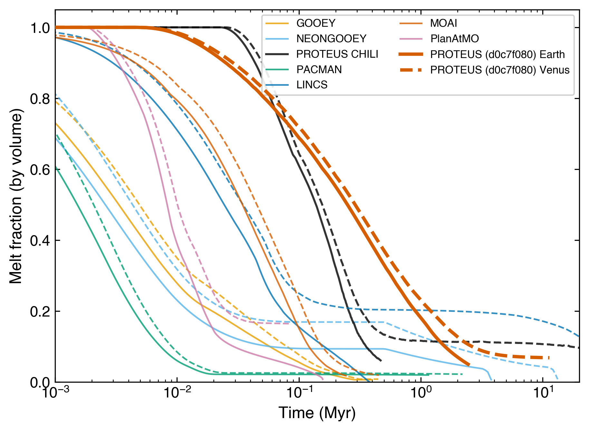{ width="100%" }
  <figcaption><strong>Figure 1.</strong> Melt fraction vs time for the CHILI Nominal Earth (solid lines) and Nominal Venus (dashed lines) cases. All seven models start fully molten and solidify within 0.1 to 4 Myr for Earth. The curves of the current PROTEUS runs show the melt fraction by mass; the curves of the intercomparison data show it by volume. The current PROTEUS Earth run reaches a melt fraction of 5% by mass at 2.44 Myr (6.2% by volume). The current PROTEUS Venus run does not reach a 5% melt fraction: its melt fraction levels off, and the run ends in global energy balance at 11.3 Myr with 6.8% of melt by mass (8.3% by volume).</figcaption>
</figure>

## Solidification milestones

<figure markdown="span">
  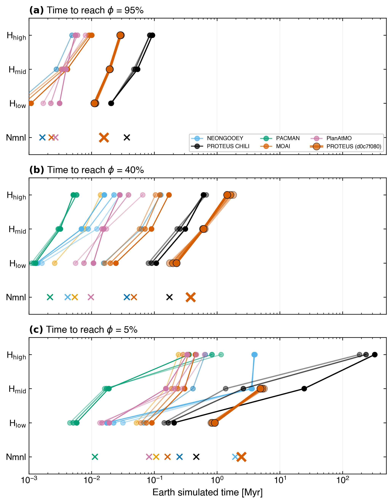{ width="100%" }
  <figcaption><strong>Figure 2.</strong> Time to reach melt fraction milestones for all Earth scenarios. (a) 95%, (b) 40%, (c) 5% melt fraction. The y-axis spans H inventories from the Nominal case (bottom) to H<sub>high</sub> (10 EO, top). C inventory is encoded as marker opacity (light = C<sub>low</sub>, medium = C<sub>mid</sub>, dark = C<sub>high</sub>). Connected scatter points trace the three H levels for each model at a given C level. The current PROTEUS run (vermillion, thick lines, black-edged markers) stands out from the CHILI intercomparison ensemble. Nominal Earth cases appear as crosses at the bottom of each panel. A current PROTEUS run that has not reached a milestone when it ends has no marker in that panel.</figcaption>
</figure>

## Atmospheric composition

<figure markdown="span">
  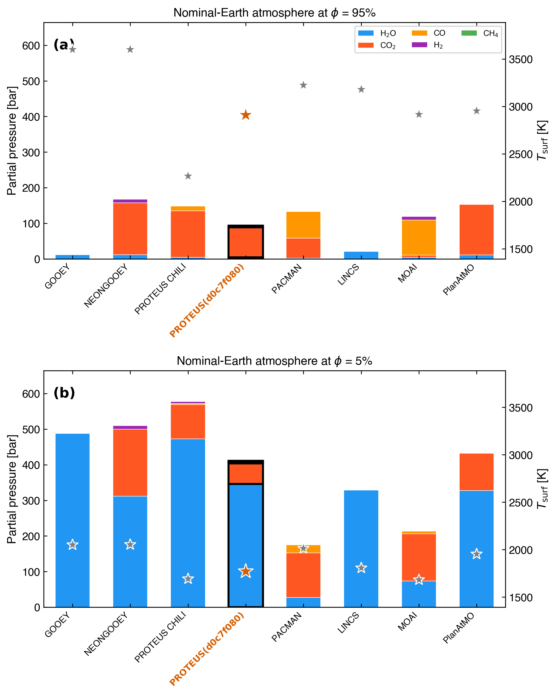{ width="100%" }
  <figcaption><strong>Figure 3.</strong> Atmospheric compositions for the Nominal Earth case at (a) 95% and (b) 5% melt fraction. Stacked bars show gas partial pressures &#91;bar&#93; for each model; grey stars mark surface temperature (right axis). The current PROTEUS run (vermillion label, black-edged bar) is placed next to the original CHILI submission for direct comparison. At 95% melt fraction, atmospheres are CO<sub>2</sub>-dominated; by 5%, H<sub>2</sub>O has exsolved from the crystallizing mantle and dominates at 346 bar for the current PROTEUS run. Both panels share the same y-axis range to highlight the pressure increase during solidification.</figcaption>
</figure>

## H and C mass budgets

<figure markdown="span">
  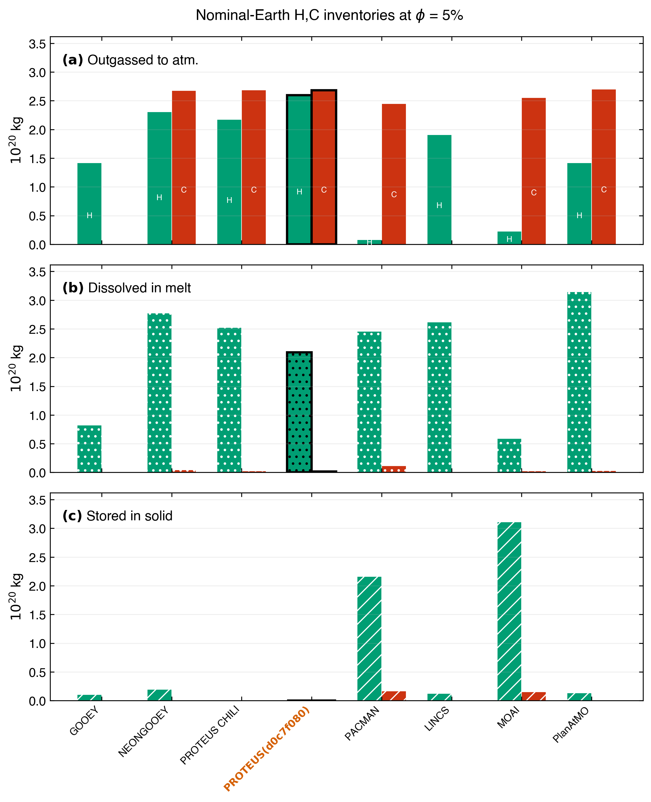{ width="100%" }
  <figcaption><strong>Figure 4.</strong> Hydrogen (green) and carbon (red) mass budgets at 5% melt fraction, distributed across three reservoirs: (a) outgassed to atmosphere, (b, dotted) dissolved in the remnant magma ocean, (c, hatched) stored in solidified mantle. The current PROTEUS run (vermillion label, black-edged bars) is placed next to the original CHILI submission. GOOEY and LINCS do not simulate carbon. MOAI and PACMAN store significant H in the solid mantle, while most other models retain H in the atmosphere or melt.</figcaption>
</figure>

## Venus atmospheric composition

<figure markdown="span">
  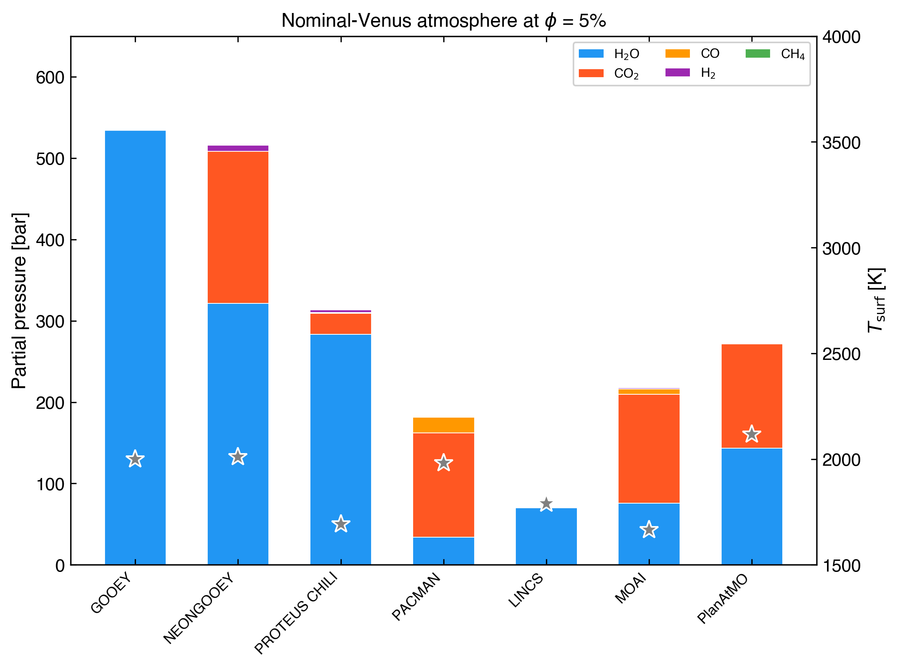{ width="100%" }
  <figcaption><strong>Figure 5.</strong> Atmospheric composition for the Nominal Venus case at 5% melt fraction. Stacked bars show gas partial pressures &#91;bar&#93;; grey stars mark surface temperature (right axis). The current PROTEUS run (vermillion label, black-edged bar) is placed next to the submitted PROTEUS CHILI result. The current run does not reach a 5% melt fraction, so the figure has no bar for it: it ends in global energy balance at 11.3 Myr with a melt fraction of 6.8% by mass (8.3% by volume), a surface temperature of 1800 K and a surface pressure of 384 bar (321 bar H<sub>2</sub>O and 56 bar CO<sub>2</sub>). The bar of the submitted PROTEUS CHILI result is its last row, at a melt fraction of 6.2% by volume.</figcaption>
</figure>

## Oxygen fugacity

<figure markdown="span">
  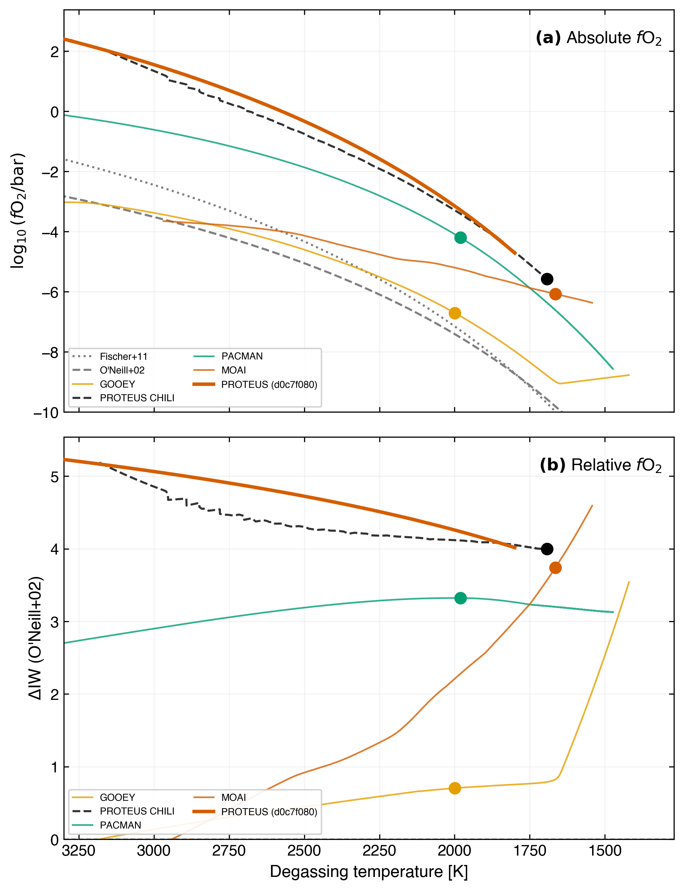{ width="100%" }
  <figcaption><strong>Figure 6.</strong> Oxygen fugacity from each model's Nominal Venus simulation, plotted as a function of degassing temperature. (a) Absolute fO<sub>2</sub> compared to the iron-wustite buffer parameterizations of Fischer et al. (2011, dotted) and O'Neill & Eggins (2002, dashed). (b) Relative fO<sub>2</sub> as delta-IW referenced to O'Neill+02. Circular markers indicate the row closest to 5% melt fraction for each model that comes within 2 percentage points of it. The curve of the current PROTEUS run (vermillion, thick line) is not an output of the run: the plotting script computes it as the IW+4 of the CHILI protocol on the buffer of Fischer et al. (2011), evaluated at the surface temperature of the run; referenced to O'Neill & Eggins (2002) in panel (b) it lies at 5.3 at 3373 K and at 4.0 at 1800 K. It has no circular marker, because the run ends at a melt fraction of 6.8%, more than 1 percentage point above 5%.</figcaption>
</figure>

## Volatile retention

<figure markdown="span">
  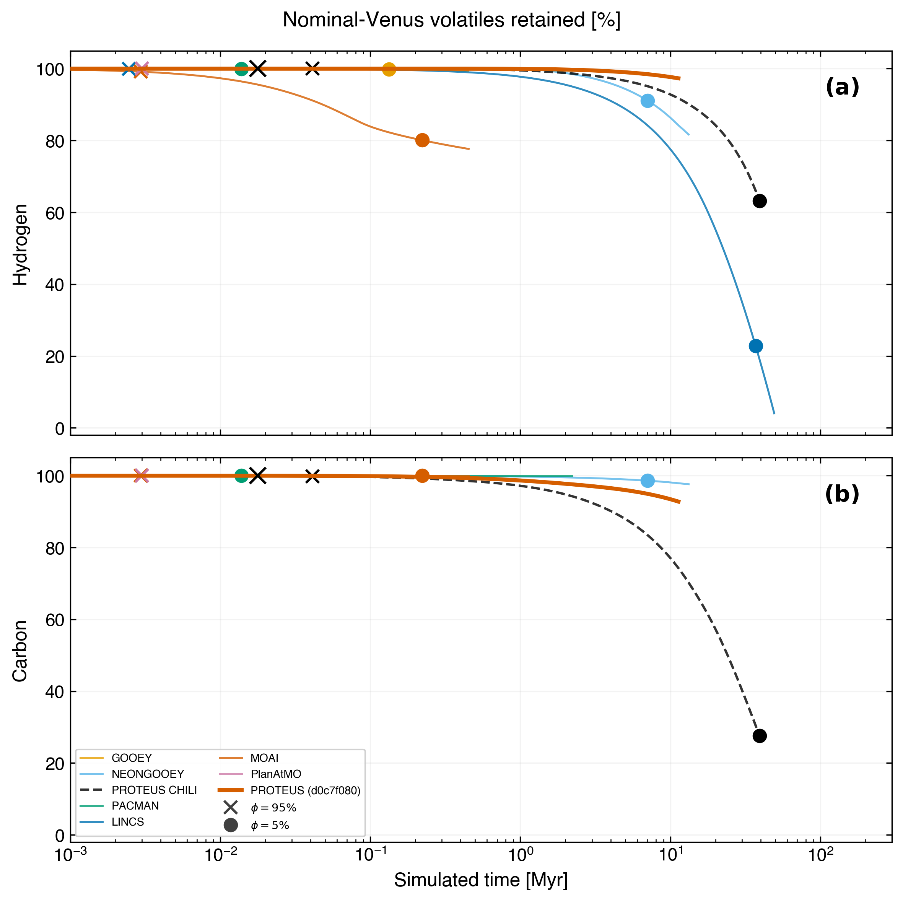{ width="100%" }
  <figcaption><strong>Figure 7.</strong> Relative amounts of the initial (a) hydrogen and (b) carbon inventories retained in the Nominal Venus case as a function of simulation time, with atoms lost from the planet by hydrodynamic escape. Crosses mark 95% melt fraction and circles mark the row closest to 5% melt fraction for each model that comes within 2 percentage points of it. The submitted PROTEUS CHILI run (black dashed) extends to 39 Myr, where its melt fraction is 6.2% by volume and it retains 63% of its hydrogen and 28% of its carbon. The current PROTEUS run (vermillion, labelled with the git commit SHA of the run) ends in global energy balance at 11.3 Myr, where it retains 97.3% of its hydrogen and 92.8% of its carbon; it has no circle, and the figure makes no statement on the escape after that time.</figcaption>
</figure>

## Outgoing longwave radiation

<figure markdown="span">
  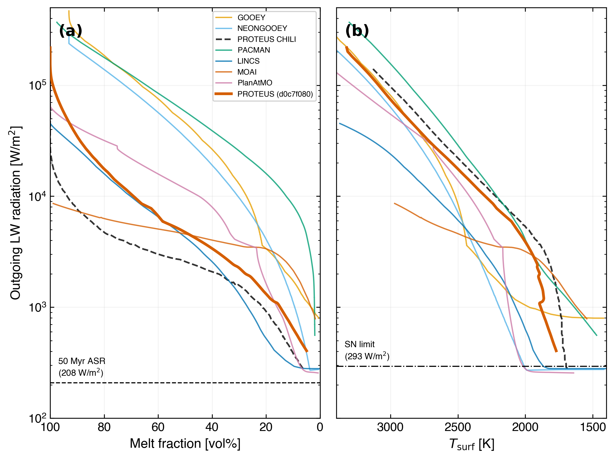{ width="100%" }
  <figcaption><strong>Figure 8.</strong> Outgoing longwave radiation flux from Nominal Earth, plotted as a function of (a) melt fraction and (b) surface temperature. In panel (a) the dashed line marks the absorbed stellar radiation (ASR = 208 W/m<sup>2</sup>) at 50 Myr stellar age with the CHILI protocol parameters. In panel (b) the dash-dot line marks the Simpson-Nakajima steam runaway limit (293 W/m<sup>2</sup>; Nakajima et al. 1992). OLR controls the cooling rate. The OLR of the current PROTEUS run decreases from 2.2 x 10<sup>5</sup> W/m<sup>2</sup> at full melt to 405 W/m<sup>2</sup> at a melt fraction of 5%; its absorbed stellar flux is 226 W/m<sup>2</sup>.</figcaption>
</figure>

## Geodynamics diagnostics

<figure markdown="span">
  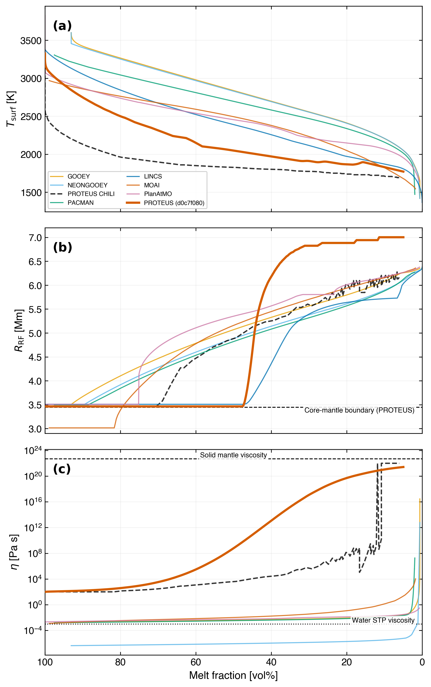{ width="100%" }
  <figcaption><strong>Figure 9.</strong> Geodynamics diagnostics as functions of melt fraction for the Nominal Earth case. (a) Surface temperature. (b) Rheological front radius in megameters; the dashed line marks the PROTEUS core-mantle boundary at 3.45 Mm (R<sub>core</sub>/R<sub>p</sub> = 0.49). (c) Effective mantle viscosity; the dashed line marks solid Earth mantle viscosity (5 x 10<sup>22</sup> Pa s), and the dotted line marks water STP viscosity (10<sup>-3</sup> Pa s). Current PROTEUS values are extracted from Aragog interior profiles at each timestep.</figcaption>
</figure>

## Surface pressure evolution

<figure markdown="span">
  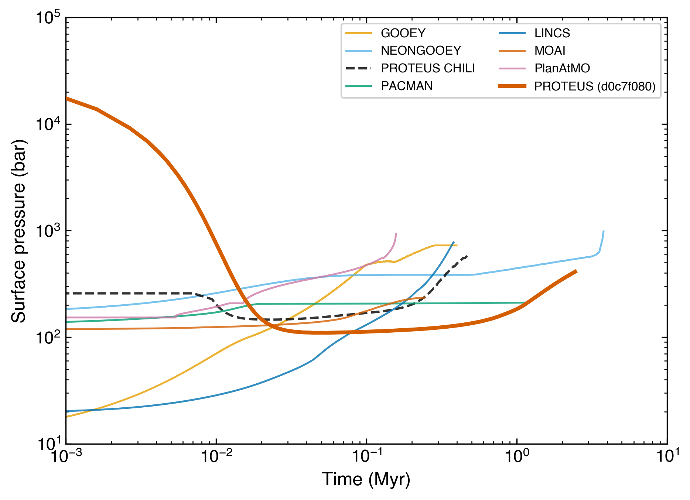{ width="100%" }
  <figcaption><strong>Figure 10.</strong> Surface pressure vs time for all models. The current PROTEUS run starts near 2.6x10<sup>4</sup> bar during the brief fully molten phase. This early peak is almost entirely molecular oxygen. CALLIOPE, the outgassing and gas-speciation module, solves the equilibrium atmospheric composition at the imposed oxygen fugacity, and because O<sub>2</sub> is one of the equilibrium species its partial pressure equals that fugacity. The CHILI protocol pins fO<sub>2</sub> at IW+4, and the iron-wustite buffer is steeply temperature-dependent, so at the magma temperature of the fully molten surface (4316 K) it places fO<sub>2</sub>, and hence pO<sub>2</sub>, near 2.6x10<sup>4</sup> bar, 99.7% of the total surface pressure. The magnitude comes from two compounding factors: the +4 dex offset multiplies the buffer value by 10<sup>4</sup>, and the high temperature already raises the iron-wustite fO<sub>2</sub> itself to a few bar. As the surface cools below ~3000 K the buffer falls by several orders of magnitude, oxygen becomes negligible, and the pressure drops to a minimum of 110 bar set by CO<sub>2</sub> partitioning before rising to 411 bar at a melt fraction of 5% as H<sub>2</sub>O exsolves from the crystallizing mantle. The submitted PROTEUS CHILI run starts with a cooler surface (3125 K) and 124 bar of O<sub>2</sub>, so no comparable spike appears. Other models differ in the timing and magnitude of the pressure evolution, reflecting their volatile solubility and oxygen treatments.</figcaption>
</figure>

## Earth volatile grid

The CHILI Earth grid varies H and C inventories across 9
combinations to explore how volatile budgets control solidification
timescale:

| | C$_\mathrm{low}$ (1.36$\times$10$^{20}$ kg) | C$_\mathrm{mid}$ (2.73$\times$10$^{20}$ kg) | C$_\mathrm{high}$ (5.44$\times$10$^{20}$ kg) |
|---|---|---|---|
| **H$_\mathrm{low}$** (1.6$\times$10$^{20}$ kg) | 1 EO, low C | 1 EO, mid C | 1 EO, high C |
| **H$_\mathrm{mid}$** (7.8$\times$10$^{20}$ kg) | 5 EO, low C | 5 EO, mid C | 5 EO, high C |
| **H$_\mathrm{high}$** (16.0$\times$10$^{20}$ kg) | 10 EO, low C | 10 EO, mid C | 10 EO, high C |

Grid configs are in `input/tutorials/chili_grid/`. Run all 9 cases:

```bash
for cfg in input/tutorials/chili_grid/*.toml; do
    name=$(basename "$cfg" .toml)
    outdir="output/chili_grid_earth_${name#earth_}"
    mkdir -p "$outdir"
    nohup proteus start --offline -c "$cfg" \
        > "/tmp/proteus_grid_${name}.log" 2>&1 & disown
done
```

Check status of running grid cases:

```bash
for d in output/chili_grid_earth_*/; do
    printf "%-40s %s\n" "$(basename $d)" "$(cat $d/status 2>/dev/null || echo 'not started')"
done
```

!!! warning "Runtime"
    Low-H cases finish in ~1 hour. Mid-H cases take ~3-5 hours. High-H
    cases (10 Earth oceans) may take 12+ hours because the thick steam
    atmosphere reduces OLR to a few hundred W m$^{-2}$ in the late
    mushy zone.

### Grid results

Solidification times for the completed grid cases:

| | C$_\mathrm{low}$ | C$_\mathrm{mid}$ | C$_\mathrm{high}$ |
|---|---|---|---|
| **H$_\mathrm{low}$** (1 EO) | 0.49 Myr | 0.53 Myr | 0.61 Myr |
| **H$_\mathrm{mid}$** (5 EO) | 2.72 Myr | 2.55 Myr | 2.42 Myr |
| **H$_\mathrm{high}$** (10 EO) | 8.85 Myr | 8.45 Myr | 7.78 Myr |

Hydrogen inventory is the primary control on solidification timescale:
a ~5x increase in H budget (1 to 5 EO) delays solidification by a
factor of ~5, and a further 2x increase (5 to 10 EO) adds another
factor of ~3 (2.5 to 8.5 Myr). The carbon effect is secondary and
non-monotonic. At low H, more CO$_2$ adds greenhouse opacity and
slows cooling (0.49 to 0.61 Myr). At mid and high H, the effect
reverses: more CO$_2$ raises P$_\mathrm{surf}$, which via Henry's
law enhances H$_2$O dissolution in the silicate melt, reducing the
atmospheric H$_2$O greenhouse and allowing higher OLR (2.72 to
2.42 Myr at mid-H; 8.85 to 7.78 Myr at high-H).

<figure markdown="span">
  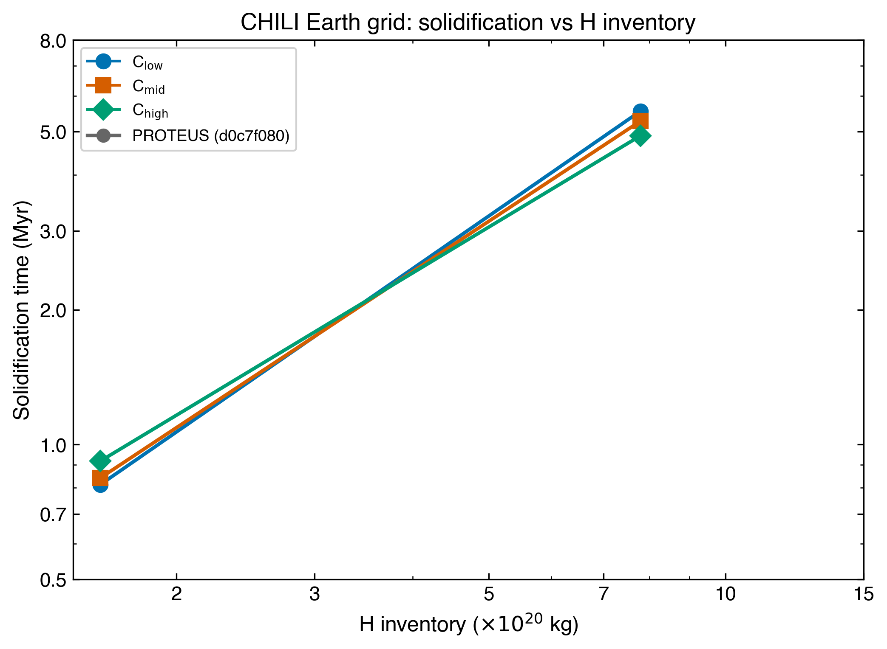{ width="80%" }
  <figcaption><strong>Figure 11.</strong> Solidification time of the current PROTEUS grid runs (solid lines, filled markers) as a function of hydrogen inventory for the three carbon levels. Where the submitted PROTEUS CHILI grid runs reach 5% melt by volume they are overlaid as dashed lines with open markers; the runs archived in the comparison repository stop just above that threshold, so no submitted points appear here. The near-linear scaling on the log-log axes reflects the blanketing effect of the steam atmosphere on OLR. The carbon-inventory dependence reverses sign between low-H and high-H cases (see text).</figcaption>
</figure>

## Current PROTEUS configuration vs the CHILI submission

The figures show two PROTEUS results, and the gap between them is itself
informative because the two come from different model configurations. The
protocol fixes the inputs that both share: a bulk-silicate-Earth
composition, oxygen fugacity at IW+4, a Bond albedo of 0.1, and a 50 Myr
stellar age [^cite-lichtenberg2026]. The two differ in the interior
modules and in the stop criteria.

The PROTEUS results submitted to the intercomparison were computed with an
earlier version of PROTEUS, not the configuration documented here. The
config file of the submitted Venus run is archived with the comparison
data (`intercomparison/inputs/proteus/evolution-proteus-venus-config.in`).
It selects **SPIDER** for the interior thermal evolution
(`interior.module = "spider"`) and the structure calculation built into
that version (`struct.module = "self"`), together with AGNI, CALLIOPE,
ZEPHYRUS and MORS. It names VULCAN for the atmospheric chemistry, set to
run only on request (`atmos_chem.when = "manually"`). Its energy balance
stop criterion is switched off. See
Lichtenberg et al. (2026) [^cite-lichtenberg2026] and Nicholls et al.
(2026) [^cite-nicholls2026] for further details.

The configuration documented on this page uses **Aragog** for the
interior thermal evolution and **Zalmoxis** for the interior structure,
with AGNI for the atmosphere, CALLIOPE for the outgassing, ZEPHYRUS for
the escape and MORS for the star. Aragog is the Python reimplementation of
SPIDER and integrates the same specific-entropy equation for a two-phase,
partially molten mantle with a mixing-length convective closure. Zalmoxis
solves the layered interior (mass, radius, density profile, and
core-mantle-boundary radius) directly and supplies the pressure-entropy
equation-of-state tables that Aragog reads. The energy balance stop
criterion is enabled in this configuration.

### The Nominal Venus case

The Nominal Venus case does not reach the solidification criterion. The
run ends on the energy balance criterion at 11.3 Myr, with a melt fraction
of 0.068 by mass (0.083 by volume). An earlier version of this page gave
2.22 Myr for Venus. That run also ended on the energy balance criterion,
at a melt fraction of 0.052 by mass (0.063 by volume). The run submitted to the intercomparison ends at 39 Myr with a melt
fraction of 0.062 by volume.

The earlier result of this page and the current one differ in the
treatment of melt-solid separation in the interior module. The earlier run
used a grain size of 0.1 m and the viscosity of the melt in the separation
velocity. The current configuration uses a grain size of 1 mm and the
viscosity of the melt-solid mixture
(`interior_energetics.aragog.separation_viscosity = "mixture"`). In the
current run the mantle crystallises as a mush with melt at all depths: at the end of the
run every node of the mantle still holds melt, between 2% and 36%.

## Takeaways

Earth and Venus begin from the same fully molten state and diverge as they
cool. Across the model ensemble both cool on million-year timescales,
and the spread between codes at any given moment reflects
differences in how each treats atmospheric opacity, volatile partitioning,
and interior convection. PROTEUS couples a radiative-convective atmosphere,
equilibrium outgassing, and a 1D interior solver, and follows the magma
ocean from the molten state to a quasi-steady state while tracking the
volatiles exchanged between the mantle and the atmosphere.

The point of this tutorial is to place the current PROTEUS against that
published ensemble on demand. The comparison figures are regenerated from
your own checkout and labelled with its git commit, so re-running the
plotting command benchmarks whatever version of PROTEUS you are running
against the fixed literature values from the CHILI papers. It is therefore
an always-current intercomparison: a quick way to see how a new PROTEUS
release compares with the submitted Earth and Venus results, and where it
lies relative to the other community codes.

---

**See also:** [Earth analogue](earth_analogue.md) | [Model description](../Explanations/model.md) | [Output format](../Reference/output.md)

 [^cite-lichtenberg2026]: Lichtenberg, T., Schaefer, L., Krissansen-Totton, J., et al., *[Coupled atmospHere Interior modeL Intercomparison (CHILI): Protocol Version 1.0](https://doi.org/10.3847/PSJ/ae593b)*, The Planetary Science Journal, 7, 108, 2026. [SciX](https://scixplorer.org/abs/2026PSJ.....7..108L/abstract).

 [^cite-nicholls2026]: Nicholls, H., Krissansen-Totton, J., Lichtenberg, T., et al., *[Coupled atmospHere Interior modeL Intercomparison (CHILI). I. Evolutionary Modelling: Primordial Magma Oceans of Earth and Venus](https://doi.org/10.48550/arXiv.2606.24757)*, arXiv:2606.24757, submitted to The Planetary Science Journal, 2026.
